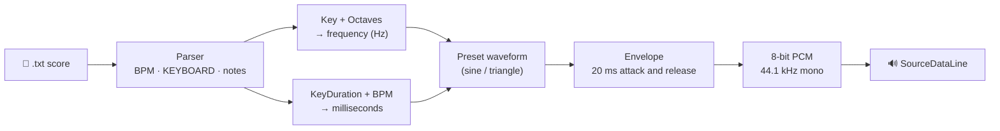
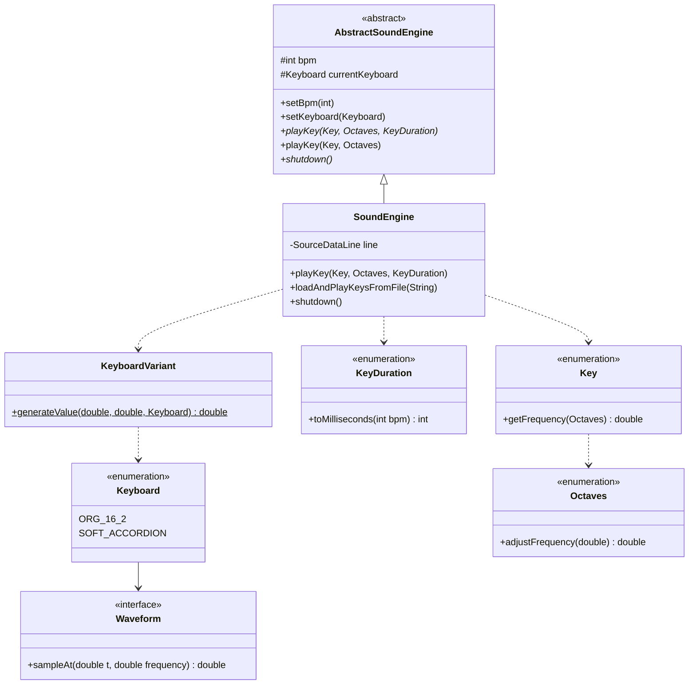

<div align="center">

# 🎹 Sound-Wrapper

**A keyboard synthesizer written in pure Java: it generates sound waves from scratch and plays scores written in plain text.**


</div>

---

## ✨ What is it?

Sound-Wrapper wraps the low-level `javax.sound.sampled` API in a simple musical interface. Instead of thinking in buffers and samples, you think in **notes, octaves, note values and BPM**.

Every note is synthesized sample by sample at 44.1 kHz. There are no pre-recorded audio files: all the sound comes from math functions.

- 🎼 **`.txt` scores**: write a song line by line and the engine plays it.
- 🎛️ **Keyboard presets**: each preset has its own waveform and volume.
- ⏱️ **Real tempo**: durations are computed from the BPM (whole, half, quarter, eighth and sixteenth notes).
- 🔇 **Smooth transitions**: a 20 ms attack and release envelope prevents clicks between notes.
- 🧩 **Extensible**: adding a new tone is just writing a lambda.

---

## 🚀 Quick start

### Requirements

- **JDK 8 or newer**
- An available audio output

### Build and run

```bash
git clone https://github.com/gilbertoanayam17/Sound-Wrapper.git
cd Sound-Wrapper

javac -d out *.java
java -cp out project.KeyboardDemo
```

Just want to check that your machine makes sound? [TestSound.java](TestSound.java) plays an A (440 Hz) for one second:

```bash
java -cp out project.TestSound
```

---

## 🎼 Write your own song

Scores are text files with one instruction per line:

```properties
# Lines starting with # are comments

# Settings (can change mid-song)
BPM=120
KEYBOARD=SOFT_ACCORDION

# Notes: KEY;OCTAVE;DURATION
C;NATURAL;QUARTER
E;NATURAL;QUARTER
G;NATURAL;HALF
C;MAJOR;WHOLE
SILENCE;NATURAL;QUARTER

# Octave and duration are optional (NATURAL and QUARTER by default)
A
```

Then play it:

```java
SoundEngine engine = new SoundEngine();
engine.loadAndPlayKeysFromFile("my_song.txt");
engine.shutdown();
```

If a line has an error, the engine reports it with its line number, falls back to the default value and keeps playing.

### Value reference

<table>
<tr>
<td valign="top">

**🎹 Keys (`Key`)**

| Key | Note | Hz |
|---|---|---|
| `C` | C4 (middle C) | 261.63 |
| `C_SHARP` | C♯4 / D♭4 | 277.18 |
| `D` | D4 | 293.66 |
| `D_SHARP` | D♯4 / E♭4 | 311.13 |
| `E` | E4 | 329.63 |
| `F` | F4 | 349.23 |
| `F_SHARP` | F♯4 / G♭4 | 369.99 |
| `G` | G4 | 392.00 |
| `G_SHARP` | G♯4 / A♭4 | 415.30 |
| `A` | A4 | 440.00 |
| `A_SHARP` | A♯4 / B♭4 | 466.16 |
| `B` | B4 | 493.88 |
| `SILENCE` | Rest | 0 |

</td>
<td valign="top">

**⏱️ Durations (`KeyDuration`)**

| Value | Quarter notes | ms at 120 BPM |
|---|---|---|
| `WHOLE` | 4 | 2000 |
| `HALF` | 2 | 1000 |
| `QUARTER` | 1 | 500 |
| `EIGHTH` | ½ | 250 |
| `SIXTEENTH` | ¼ | 125 |

`ms = quarter notes × 60000 / BPM`

**🎚️ Octaves (`Octaves`)**

| Value | Shift |
|---|---|
| `MINOR` | one octave down (−12 semitones) |
| `NATURAL` | middle octave (C4 to B4) |
| `MAJOR` | one octave up (+12 semitones) |

> Here `MINOR` and `MAJOR` mean a lower or higher octave, not a minor or major key.

**🎛️ Presets (`Keyboard`)**

| Preset | Wave | Volume |
|---|---|---|
| `ORG_16_2` | Sine | 0.9 |
| `SOFT_ACCORDION` | Triangle | 0.8 |

</td>
</tr>
</table>

---

## 🎵 Included songs

| File | Song | BPM | Preset |
|---|---|---|---|
| [`Teardrop.txt`](Teardrop.txt) | Teardrop (Massive Attack) | 134 | `ORG_16_2` |
| [`MofL.txt`](MofL.txt) | Mystery of Love (Sufjan Stevens) | 132 | `SOFT_ACCORDION` |
| [`Air_PL.txt`](Air_PL.txt) | Highschool Lover (Air) | 143 | `SOFT_ACCORDION` |

---

## 🧑‍💻 Using it from code

You can also play notes directly, without a file:

```java
SoundEngine engine = new SoundEngine();

engine.setBpm(110);
engine.setKeyboard(Keyboard.SOFT_ACCORDION);

engine.playKey(Key.F_SHARP, Octaves.NATURAL, KeyDuration.EIGHTH);
engine.playKey(Key.C_SHARP, Octaves.NATURAL);               // quarter note by default
engine.playKey(Key.G_SHARP, Octaves.MINOR, KeyDuration.HALF);

engine.shutdown(); // drains the buffer and closes the audio line
```

---

## ⚙️ How it works



1. **Frequency:** each `Key` stores its base frequency and `Octaves` multiplies it by `2^(semitones/12)`.
2. **Duration:** `KeyDuration` converts the note value to milliseconds based on the BPM, and from there to a number of samples.
3. **Synthesis:** for each sample, the active preset's `Waveform` computes the amplitude at time `t`.
4. **Envelope:** amplitudes rise from 0 to 1 over the first 20 ms and fall back to 0 over the last 20 ms. If the note is shorter, the envelope is split in half.
5. **Output:** the result is scaled to a signed `byte` and written to a single shared `SourceDataLine`.

<details>
<summary><b>📐 Class diagram</b></summary>



</details>

---

## 🧩 Adding a new tone

A preset is a name, a volume and a function `(t, f) -> amplitude` that returns values between −1 and 1. For example, a square wave only needs one new entry in [Keyboard.java](Keyboard.java):

```java
SQUARE_LEAD("SQUARE_LEAD", 0.5,
        (t, f) -> Math.signum(Math.sin(2.0 * Math.PI * f * t))),
```

From then on you can use it in your scores with `KEYBOARD=SQUARE_LEAD`.

---

## 📁 Project structure

```
Sound-Wrapper/
├── AbstractSoundEngine.java   # Engine base: BPM, preset and playback contract
├── SoundEngine.java           # javax.sound implementation + score parser
├── Key.java                   # The 12 notes of the middle octave + rest
├── Octaves.java               # Octave shift (−12 / 0 / +12 semitones)
├── KeyDuration.java           # Note values and conversion to milliseconds
├── Keyboard.java              # Keyboard presets (waveform + volume)
├── Waveform.java              # Functional interface for waveforms
├── KeyboardVariant.java       # Evaluates the active preset's waveform
├── KeyboardDemo.java          # Entry point: plays a song
├── TestSound.java             # Minimal audio test (A 440 Hz)
└── *.txt                      # Example scores
```

---

<div align="center">

Made with ☕ and sine waves.

</div>
