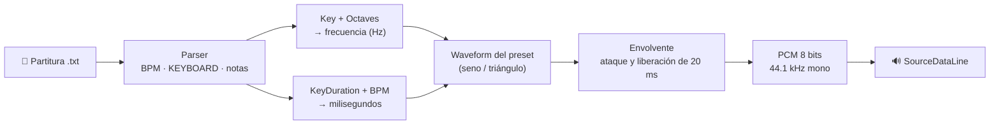
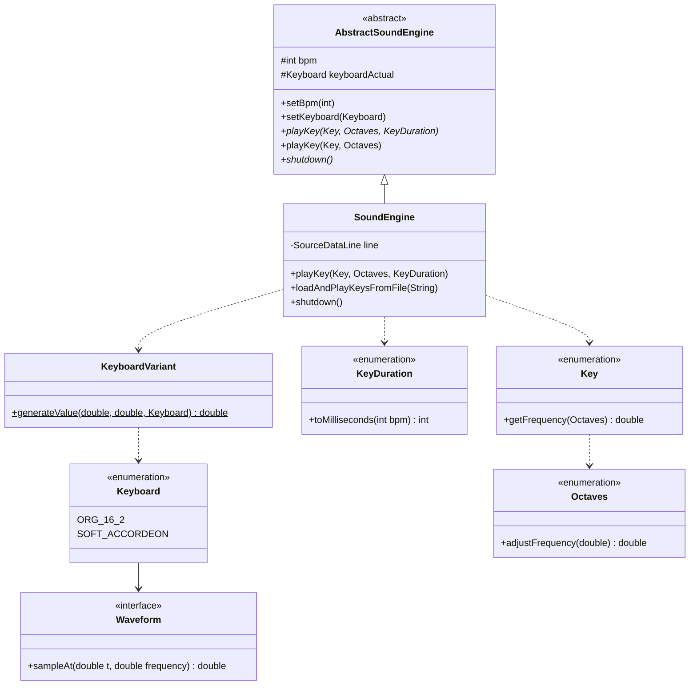

<div align="center">

# 🎹 Sound-Wrapper

**Un sintetizador de teclado escrito en Java puro: genera ondas sonoras desde cero y toca partituras escritas en texto plano.**


</div>

---

## ✨ ¿Qué es?

Sound-Wrapper envuelve la API de bajo nivel `javax.sound.sampled` en una interfaz musical sencilla. En lugar de pensar en buffers y muestras, piensas en **notas, octavas, figuras rítmicas y BPM**.

Cada nota se sintetiza muestra por muestra a 44.1 kHz. No hay archivos de audio pregrabados: todo el sonido sale de funciones matemáticas.

- 🎼 **Partituras en `.txt`**: escribe una canción línea por línea y el motor la interpreta.
- 🎛️ **Presets de teclado**: cada preset tiene su propia forma de onda y volumen.
- ⏱️ **Tempo real**: las duraciones se calculan a partir del BPM (redonda, blanca, negra, corchea y semicorchea).
- 🔇 **Transiciones suaves**: una envolvente de ataque y liberación de 20 ms evita los "clics" entre notas.
- 🧩 **Extensible**: agregar un timbre nuevo es escribir una lambda.

---

## 🚀 Inicio rápido

### Requisitos

- **JDK 8 o superior**
- Una salida de audio disponible

### Compilar y ejecutar

```bash
git clone https://github.com/gilbertoanayam17/Sound-Wrapper.git
cd Sound-Wrapper

javac -d out *.java
java -cp out proyecto.KeyboardDemo
```

¿Solo quieres comprobar que tu equipo suena? [TestSound.java](TestSound.java) toca un La (440 Hz) durante un segundo:

```bash
java -cp out proyecto.TestSound
```

---

## 🎼 Escribe tu propia canción

Las partituras son archivos de texto con una instrucción por línea:

```properties
# Las líneas que empiezan con # son comentarios

# Configuración (puede cambiar a mitad de la canción)
BPM=120
KEYBOARD=SOFT_ACCORDEON

# Notas: TECLA;OCTAVA;DURACIÓN
C;NATURAL;NEGRA
E;NATURAL;NEGRA
G;NATURAL;BLANCA
C;MAJOR;REDONDA
SILENCE;NATURAL;NEGRA

# La octava y la duración son opcionales (NATURAL y NEGRA por defecto)
A
```

Luego reprodúcela:

```java
SoundEngine engine = new SoundEngine();
engine.loadAndPlayKeysFromFile("mi_cancion.txt");
engine.shutdown();
```

Si una línea tiene un error, el motor lo reporta con su número de línea, usa el valor por defecto y sigue tocando.

### Referencia de valores

<table>
<tr>
<td valign="top">

**🎹 Teclas (`Key`)**

| Tecla | Nota | Hz |
|---|---|---|
| `C` | Do | 261.63 |
| `C_SHARP` | Do# / Re♭ | 277.18 |
| `D` | Re | 293.66 |
| `D_SHARP` | Re# / Mi♭ | 311.13 |
| `E` | Mi | 329.63 |
| `F` | Fa | 349.23 |
| `F_SHARP` | Fa# / Sol♭ | 369.99 |
| `G` | Sol | 392.00 |
| `G_SHARP` | Sol# / La♭ | 415.30 |
| `A` | La | 440.00 |
| `A_SHARP` | La# / Si♭ | 466.16 |
| `B` | Si | 493.88 |
| `SILENCE` | Silencio | 0 |

</td>
<td valign="top">

**⏱️ Duraciones (`KeyDuration`)**

| Figura | Negras | ms a 120 BPM |
|---|---|---|
| `REDONDA` | 4 | 2000 |
| `BLANCA` | 2 | 1000 |
| `NEGRA` | 1 | 500 |
| `CORCHEA` | ½ | 250 |
| `SEMICORCHEA` | ¼ | 125 |

`ms = negras × 60000 / BPM`

**🎚️ Octavas (`Octaves`)**

| Valor | Desplazamiento |
|---|---|
| `MINOR` | una octava abajo (−12 semitonos) |
| `NATURAL` | octava central (Do4 a Si4) |
| `MAJOR` | una octava arriba (+12 semitonos) |

> Aquí `MINOR` y `MAJOR` indican octava más grave o más aguda, no tonalidad menor o mayor.

**🎛️ Presets (`Keyboard`)**

| Preset | Onda | Volumen |
|---|---|---|
| `ORG_16_2` | Senoidal | 0.9 |
| `SOFT_ACCORDEON` | Triangular | 0.8 |

</td>
</tr>
</table>

---

## 🎵 Canciones incluidas

| Archivo | Canción | BPM | Preset |
|---|---|---|---|
| [`Teardrop.txt`](Teardrop.txt) | Teardrop (Massive Attack) | 134 | `ORG_16_2` |
| [`MofL.txt`](MofL.txt) | Mystery of Love (Sufjan Stevens) | 132 | `SOFT_ACCORDEON` |
| [`Air_PL.txt`](Air_PL.txt) | Highschool Lover (Air) | 143 | `SOFT_ACCORDEON` |

---

## 🧑‍💻 Uso desde código

También puedes tocar notas directamente, sin archivo:

```java
SoundEngine engine = new SoundEngine();

engine.setBpm(110);
engine.setKeyboard(Keyboard.SOFT_ACCORDEON);

engine.playKey(Key.F_SHARP, Octaves.NATURAL, KeyDuration.CORCHEA);
engine.playKey(Key.C_SHARP, Octaves.NATURAL);               // negra por defecto
engine.playKey(Key.G_SHARP, Octaves.MINOR, KeyDuration.BLANCA);

engine.shutdown(); // vacía el buffer y cierra la línea de audio
```

---

## ⚙️ Cómo funciona



1. **Frecuencia:** cada `Key` guarda su frecuencia base y `Octaves` la multiplica por `2^(semitonos/12)`.
2. **Duración:** `KeyDuration` convierte la figura a milisegundos según el BPM, y de ahí a número de muestras.
3. **Síntesis:** para cada muestra, el `Waveform` del preset activo calcula la amplitud en el instante `t`.
4. **Envolvente:** las amplitudes suben de 0 a 1 en los primeros 20 ms y bajan a 0 en los últimos 20 ms. Si la nota es más corta, se reparte a la mitad.
5. **Salida:** el resultado se escala a un `byte` con signo y se escribe en una única `SourceDataLine` compartida.

<details>
<summary><b>📐 Diagrama de clases</b></summary>



</details>

---

## 🧩 Agregar un nuevo timbre

Un preset es un nombre, un volumen y una función `(t, f) -> amplitud` que devuelve valores entre −1 y 1. Por ejemplo, para una onda cuadrada basta con añadir una entrada en [Keyboard.java](Keyboard.java):

```java
SQUARE_LEAD("SQUARE_LEAD", 0.5,
        (t, f) -> Math.signum(Math.sin(2.0 * Math.PI * f * t))),
```

Desde ese momento ya puedes usarlo en tus partituras con `KEYBOARD=SQUARE_LEAD`.

---

## 📁 Estructura del proyecto

```
Sound-Wrapper/
├── AbstractSoundEngine.java   # Base del motor: BPM, preset y contrato de reproducción
├── SoundEngine.java           # Implementación con javax.sound + parser de partituras
├── Key.java                   # Las 12 notas de la octava central + silencio
├── Octaves.java               # Desplazamiento de octava (−12 / 0 / +12 semitonos)
├── KeyDuration.java           # Figuras rítmicas y conversión a milisegundos
├── Keyboard.java              # Presets de teclado (forma de onda + volumen)
├── Waveform.java              # Interfaz funcional para formas de onda
├── KeyboardVariant.java       # Evalúa la onda del preset activo
├── KeyboardDemo.java          # Punto de entrada: reproduce una canción
├── TestSound.java             # Prueba mínima de audio (La 440 Hz)
└── *.txt                      # Partituras de ejemplo
```

---

<div align="center">

Hecho con ☕ y ondas senoidales.

</div>
